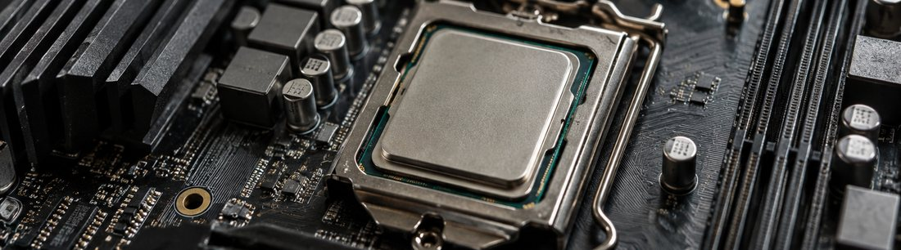
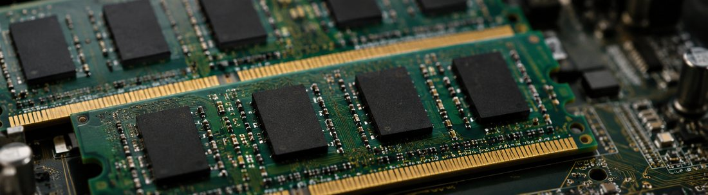

# BitLab

Jogo de Arquitetura Computacional com **cruzadinha**, **Termo** e **estatísticas do jogador**.



## Organização dos arquivos

```text
BitLab/
├── index.html
├── estatisticas.html
├── css/
│   └── style.css
├── javascript/
│   └── script.js
├── imagens/
│   ├── processador.jpg
│   └── memoria.jpg
└── README.md
```

- **index.html:** página do jogo.
- **estatisticas.html:** resultados, XP e níveis.
- **style.css:** aparência das páginas.
- **script.js:** funcionamento dos jogos e das estatísticas.

## Como executar

1. Baixe o projeto e extraia o arquivo ZIP.
2. Abra a pasta **BitLab**.
3. Clique duas vezes em **index.html** para abrir no navegador.
4. Use o menu **Estatísticas** para acompanhar os resultados.

Não é necessário instalar nada. Para carregar o gráfico Chart.js, é preciso ter internet.


